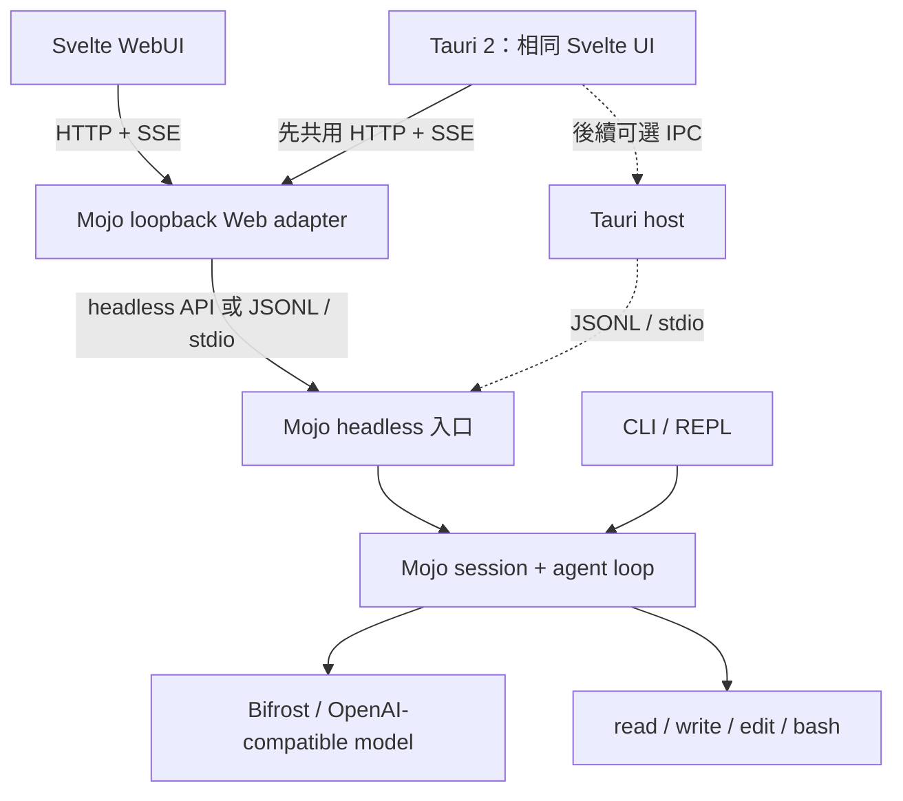

# WebUI 與 Desktop 規劃

狀態：規劃，尚未實作。

分析基準：`docs/architecture-diagrams` 分支的 `620fd4f`。

相依規劃：[interactive-streaming-cli](../openspec/changes/interactive-streaming-cli/design.md)。

## 目標

用一套簡潔、可擴充的工作台介面，呈現現有 Mojo coding agent 的對話、工具執行、檔案變更與核准狀態；瀏覽器與桌面版共用 UI 及領域事件，不在前端複製 agent 邏輯。

### 選型結論

| 層次 | 選擇 | 理由 |
|---|---|---|
| Web UI | **Svelte 5 + TypeScript + Vite** | 元件與狀態寫法精簡，輸出靜態 SPA，適合本機工作台 |
| 樣式 | 原生 CSS、design tokens、元件 scoped styles | 保持視覺一致，不用大型 UI framework 決定產品外觀 |
| 共用狀態 | Svelte 5 Runes 與 `.svelte.ts` | 以明確狀態模型處理 session、run 與工具事件，不先引入全域狀態框架 |
| 通訊 | HTTP JSON、SSE；headless 邊界使用 JSONL／stdio | 分別處理瀏覽器事件與桌面程序整合，不共用兩種 streaming 協定 |
| Agent 核心 | **繼續使用 Mojo** | CLI、WebUI 與 Desktop 共用 session、tool loop、權限與錯誤語意 |
| Desktop | **優先驗證 Tauri 2** | 沿用同一套 SPA，透過 sidecar 管理 Mojo 程序 |
| 驗證 | `svelte-check`、Vitest、Playwright；既有 Mojo 測試 | 分別驗證事件處理、元件、端到端流程與核心行為 |

Svelte 5 使用 Runes（`$props`、`$state`、`$derived`、`$effect`）與標準事件屬性；新程式不以 Svelte 4 的 `export let`、`$:`、`on:` 作為基礎。Vite SPA 是目前的起點，不表示未來不能使用 SvelteKit。

如果很快需要 `/workspaces/...`、`/sessions/...`、設定頁與巢狀 layout，可改用 SvelteKit 的 SPA 模式及 `adapter-static`。本機與桌面版不依賴 SvelteKit SSR 或另一個 Node.js application server。

## 現況與可重用邊界

| 項目 | `620fd4f` 現況 | UI 需要的改變 |
|---|---|---|
| Agent 核心 | Mojo 執行模型呼叫、工具與結果回填 | 保留共用 loop，不複製到 TypeScript |
| 模型回覆 | `client.mojo` 使用 `stream: false` | 等既有串流規劃落地後顯示 content delta |
| 對話歷史 | `agent.run()` 每次建立 messages | 由外部 session owner 持有，agent 執行一次使用者提交 |
| 執行進度 | `print("[tool]", name)` | 透過 output sink 交付機器可讀事件 |
| Web 服務 | 沒有；`support/http.mojo` 是模型 HTTP client | 新增獨立本機 Web adapter，不與模型 transport 混用 |
| OpenSpec | 已規劃單次提交入口、output sink、REPL 與模型 SSE | 先落地共用入口與 sink，再接 UI adapter |

`interactive-streaming-cli` 的「外部持有 messages」及「單次使用者提交」是 WebUI 的直接相依項。Terminal、JSONL 與 Web 事件輸出是同一個 agent 的不同呈現／transport adapter；不是三個不同的 agent。

模型服務到 Mojo 的 Chat Completions SSE，與 Mojo 到 WebUI 的任務事件 SSE，是兩個獨立邊界。即使第一版不啟用模型文字串流，WebUI 仍需要工具開始、工具完成及任務完成事件。

## 目標架構



### 責任分配

**Mojo 持有真正的執行狀態：**

- 對話歷史、目前 run、模型 request 與工具分派。
- workspace、允許的工具與執行政策。
- 完成、失敗、取消與資源清理。
- 對外事件的順序及必要的敏感資料裁切。

**Svelte 負責：**

- 提交 prompt、查詢 session、停止 run、回覆核准。
- 把事件整理成 UI 狀態，不依賴解析人類可讀的 terminal 輸出。
- 顯示訊息、工具紀錄、diff、檔案樹與其他受支援的 artifact。

**Web adapter 負責：**

- 提供靜態 SPA、HTTP endpoints 與 SSE。
- 驗證 request、執行 loopback 存取政策及連線生命週期。
- 將 Web 操作轉交 headless 入口；不重新實作工具政策。

**Tauri host 負責：**

- 啟動、監控及關閉 Mojo sidecar。
- 桌面視窗、原生整合與必要的程序權限。
- 初版先連接同一個 loopback Web adapter；有明確需求後才改成 IPC／stdio。

這個順序避免同時驗證兩套桌面通訊路徑。若改用 Tauri IPC，Svelte 元件仍只依賴 `AgentClient`，不改變對話與工具元件。

## 協定與前端邊界

### Headless 與 Web 協定

先定義小型、版本化的機器協定，再建立 UI。stdout 只承載 JSONL 協定，stderr 只承載診斷；任一事件一行，嚴格 UTF-8，不在 JSON 字串外夾帶 terminal 提示。

共同 envelope：

```json
{
  "protocol": 1,
  "session_id": "session-01",
  "run_id": "run-01",
  "seq": 4,
  "type": "tool.started",
  "data": {}
}
```

`session_id` 與 `run_id` 是 opaque ID；`seq` 在同一 run 嚴格遞增，由 Mojo 產生。前端不依賴 ID 的格式或時間戳排序。第一版不承諾斷線後重播；若加入重連，再以明確的 replay cursor 與保存上限設計，不假裝 browser `Last-Event-ID` 自動提供完整恢復。

第一組領域事件：

| 事件 | 必要語意 | UI 用途 |
|---|---|---|
| `run.started` | 任務已接受 | 顯示執行狀態與停止操作 |
| `assistant.delta` | 一個 content delta，不是保證逐 token | 增量加入回答 |
| `assistant.completed` | 完整、驗證過的模型回應已提交至 history | 結束回答段，不重印全文 |
| `tool.started` | 一個工具開始，附穩定 `tool_call_id` | 建立工具項目 |
| `tool.finished` | 工具結果、狀態與必要診斷 | 顯示輸出、exit code、timeout 或錯誤 |
| `approval.requested` | 工具等待政策決定 | 顯示差異與允許／拒絕 |
| `run.completed` | 任務完整完成 | 允許下一個提交 |
| `run.failed` | 任務失敗及 session 可否繼續 | 顯示可恢復操作，不假裝已復原副作用 |
| `artifact.created` | 受支援的結構化顯示資料 | 開啟 diff、表格、檔案樹等視圖 |

初版不啟用文字串流時，可省略 `assistant.delta`，但不能以 `run.completed` 代替每個工具事件。完整 tool call 驗證通過之前不得提前執行工具；部分 assistant response 不進入 history。

每個 session 同時只接受一個 active run；新提交須在 ready 狀態。停止、拒絕核准與關閉視窗是不同操作，不能混為一談。

### `AgentClient`

前端只有這個平台邊界知道 HTTP、SSE 或 Tauri IPC：

```ts
interface AgentClient {
  submit(sessionId: string, prompt: string): Promise<RunHandle>;
  events(runId: string): AsyncIterable<AgentEvent>;
  stop(runId: string): Promise<void>;
  session(sessionId: string): Promise<SessionSnapshot>;
  approve(requestId: string, decision: ApprovalDecision): Promise<void>;
}
```

這是責任示意，不要求逐字採用此 TypeScript API。第一版可使用 `fetch()` 與 SSE client；`EventSource` 適合單向 GET stream，但自訂 header、POST 與錯誤處理須在實作時確認，不能預設它滿足所有驗證需求。

元件不直接 import Tauri API，也不自行啟動 Mojo 程序。桌面環境偵測集中在 client adapter 或 composition root。

## 視覺與擴充方式

### 預設安靜，需要時展開

```text
┌──────────────┬────────────────────────────┬──────────────────┐
│ Workspace    │ 對話與精簡工具時間線       │ Inspector        │
│ Sessions     │                            │ 按需開啟         │
│              │                            │ diff / log / ... │
├──────────────┴────────────────────────────┴──────────────────┤
│ Prompt composer                       Status / Stop / Send   │
└───────────────────────────────────────────────────────────────┘
```

桌面寬畫面可顯示三欄，平常收起 inspector；窄畫面改為單欄與 drawer，不縮小成難以操作的三欄。

視覺採中性表面、明確字級、可讀行寬、細邊界與少量強調色。成功、失敗、等待核准使用語意色，但狀態不能只靠顏色辨識。支援鍵盤 focus、對比、reduced motion，以及繁中輸入法 composition；composition 期間的 Enter 不應誤送 prompt。

### 以顯示類型擴充，而不是解析文字猜型別

| Artifact／事件 | 預設呈現 | 展開視圖 |
|---|---|---|
| `tool.started`／`tool.finished` | 名稱、狀態、耗時 | 有界輸出、exit code、診斷 |
| `artifact:diff` | 檔案與增減摘要 | Diff viewer |
| `artifact:file-tree` | 路徑摘要 | 可折疊 File Tree |
| `artifact:table` | 標題與筆數 | Table |
| `artifact:chart` | 標題與說明 | 按需載入的圖表 |
| `approval.requested` | 風險與工具名稱 | 參數／diff、允許／拒絕 |

使用 typed event／artifact registry 對應 Svelte renderer；未知類型顯示安全的通用摘要，不令整個對話失效。模型不能直接提供可執行 HTML 或 JavaScript；未來若有生成式 UI，只接受白名單 `ViewSpec`，不透過 `{@html}` 執行未信任內容。

### UI 元件策略

不從零重寫 dialog、menu、keyboard navigation 等基礎設施，也不為每個狀態套用卡片。

- 基礎元件可採 **shadcn-svelte**，保留專案自己的 tokens 與版面。
- 其 AI Elements 的 Chat、Tool、Plan、File Tree、Confirmation、Terminal patterns 可作為結構參考。
- 範例若使用 AI SDK，只借用 UI pattern，接線換成自己的 `AgentClient`；不因此改變 Mojo＋Bifrost 架構。
- 需要程式碼檢視／編輯時再加入 **CodeMirror 6**。
- 真正圖表才按需載入 ECharts；進度與簡單狀態使用 CSS／SVG。

引入前應鎖定版本並檢查實際 API、維護狀態與 accessibility；AI Elements 是可用 pattern，不是本專案既有依賴。

第一版 Terminal 是工具執行紀錄，不是互動 shell。現有工具 stdin 為 `/dev/null`，沒有 PTY；shell、vim、tmux 需要另行設計終端模擬器與 PTY 後端。

## 效能與資源上限

Svelte 的編譯式更新不能替代資料管理：

- content delta 先累積，以 `requestAnimationFrame` 或短間隔更新 DOM。
- message、run、tool 使用穩定 ID，避免每個 delta 重建整個時間線。
- tool output 有大小上限與明確 `truncated`；大型 log 預設折疊、分段取得。
- 長列表在實測需要時才 virtualization；保留搜尋、選取及無障礙行為。
- Diff、CodeMirror、ECharts、大型 JSON viewer 使用 dynamic import。
- 不把 API key、完整模型 response 或未裁切的 shell 環境放進前端事件。

## 安全與生命週期

這個 agent 能寫檔及執行 shell；「本機 HTTP」不代表可以省略存取控制。

第一版 Web adapter 必須：

- 只綁 `127.0.0.1`／`::1`，不預設暴露 LAN 或 `0.0.0.0`。
- 使用每次啟動產生的高熵 session capability，限制 Origin／Host，並拒絕未授權跨來源操作；不只依賴 CORS。
- 獨立瀏覽器模式由啟動端以一次性本機 bootstrap 交付 capability，再以記憶體中的 authorization 使用；不放入 URL query、event log 或持久化前端儲存。Tauri 由受控 host 注入。具體流程在 Web adapter 設計中驗證，不能假設 browser sandbox 能防禦同機惡意程序。
- 限制 request body、事件數、輸出大小、連線數及執行時間；驗證 JSON 與 ID 歸屬。
- 初版由啟動端固定 workspace，不讓任意網頁用 request 選擇任意本機路徑。
- 模型憑證保留在 Mojo／Bifrost 邊界，絕不送入瀏覽器或寫入事件。
- 預設不啟用遠端、多用戶、公開 tunnel 或無審核 bash。

停止 run 必須清理受管理的 curl／工具 process group；已完成 write／edit 不回滾。既有 CLI 的 Ctrl-C 是清理後退出，不等同「取消本輪並保留同一 session」。WebUI 的 Stop 一開始忠實對應可用語意；若要取消後續聊，需另改 agent 狀態機與測試。

關閉 Tauri 視窗前，需明確決定停止或保留背景 run，顯示目前狀態，並保證孤兒程序不繼續寫入。

## Desktop 驗證與分發

Tauri 2 可將 Mojo executable 作為 sidecar；每個作業系統／CPU 架構需對應 target binary。它使用系統 WebView，Electron 則內含 Chromium 與 Node.js main process；這是執行環境與整合方式的取捨，不預先宣稱固定的安裝大小或 RAM 優勢。

### 兩個交付階段

1. **開發／個人使用版**：連接或啟動已安裝的 Pixi 環境，驗證 UI、sidecar 與生命週期。
2. **可交付安裝版**：處理 Mojo runtime、共享函式庫、curl、`tools.json`、架構命名與相對資源路徑；在沒有開發環境的乾淨機器驗證。

目前編譯後的 executable 仍依賴 Pixi 環境中的 Mojo runtime 與 curl，不能只複製單一 binary 就宣稱可分發。

平台維持 macOS ARM64、Linux x86-64／ARM64；POSIX process 層不支援原生 Windows。Windows Desktop 可先連接 WSL 或遠端受控 runtime，但 WSL 的程序終止、檔案路徑與壽命必須另行驗證；不把這視為原生 Windows agent 已完成。

### 提早建立最薄的 Tauri smoke test

WebUI 初版即以一個最薄視窗載入相同 build，在目標機器驗證：

- 繁中 IME、快捷鍵、剪貼簿與焦點。
- 長訊息捲動、程式碼區塊及 reduced motion。
- sidecar 啟動失敗、模型離線、停止 run、關閉視窗與重開。
- Omarchy／Linux 的 NVIDIA、Wayland、WebKitGTK 顯示與輸入。

Tauri 官方記錄部分 Linux NVIDIA／Wayland 圖形問題，不能假設目標環境一定受影響或一定正常。若 smoke test 證明不合需求，再評估 Electron；Svelte UI、領域協定與 Mojo 核心仍可沿用。

## 分階段實作與驗收

### Phase 0：共用核心契約

先完成 `interactive-streaming-cli` 中與 UI 共用的小型子集，不必等整個 REPL 完成：

- [ ] 外部持有 messages，agent 提供單次使用者提交入口。
- [ ] output sink 提供 assistant 與 tool 生命週期，不再依賴 `print` 作為機器介面。
- [ ] 定義 protocol version、session／run／tool ID、事件順序與錯誤狀態。
- [ ] 保留完整 response 才入 history、工具完整驗證後才執行的規則。
- [ ] 用現有 Mojo mock server 驗證兩次提交、工具結果配對、失敗與資源清理。

**完成條件：**CLI 與記憶體測試使用同一個提交入口，能重放固定事件 fixture 而不呼叫真實模型。

### Phase 1：可用的 WebUI 垂直切片

- [ ] 建立 Svelte 5、TypeScript、Vite SPA 與最小 design tokens。
- [ ] 建立 Mojo headless 入口及 loopback Web adapter，提供提交、事件與狀態查詢。
- [ ] 實作 HTTP `AgentClient`、事件 reducer 與未知事件 fallback。
- [ ] 完成固定 workspace、單一 prompt、回答、四工具事件、成功／失敗顯示。
- [ ] 實作停止及程序清理；未做 session resume 前不明示可恢復。
- [ ] 測試 UTF-8 切塊、delta 不重複、亂序／缺號處理、長輸出與連線中斷。
- [ ] 以 Playwright 跑一個完整離線任務，並驗證未授權 Origin／request 無法執行工具。

**完成條件：**不用 API key，以本機假模型即可完成「提交 → 工具 → 回答 → 停止／失敗」；現有 `pixi run test` 無回歸。

### Phase 2：薄 Tauri 外殼

- [ ] 用相同 SPA build 建立 Tauri 2 視窗，先沿用 HTTP `AgentClient`。
- [ ] 管理 Mojo sidecar 與 `tools.json` 資源，記錄不洩漏憑證的啟動診斷。
- [ ] 驗證停止、視窗關閉、異常退出與重開的程序生命週期。
- [ ] 在 macOS ARM64 與目標 Linux 環境執行桌面 smoke test。
- [ ] 記錄 Windows／WSL 的限制，不宣稱原生支援。
- [ ] 只有明確需要時，新增 stdio／IPC `AgentClient` 並以相同 contract tests 驗證。

**完成條件：**Web 與 Desktop 對同一組事件 fixture 呈現一致狀態，關閉或停止後沒有受管理孤兒程序。

### Phase 3：工作台與視覺化

- [ ] 設計 session 落盤、原子寫入、版本遷移與恢復，不只把 JSON 存進 localStorage。
- [ ] 加入檔案變更清單、diff、工具核准與取消後續聊的明確狀態。
- [ ] 加入 artifact registry、必要的 CodeMirror／圖表 lazy loading。
- [ ] 對大型歷史、工具輸出與 diff 做效能及 accessibility 驗證。
- [ ] 有互動 shell 的實際需求時，另提 PTY 設計，不改稱現有 bash log 為 terminal。

**完成條件：**重開後能恢復明確支援的 session 狀態；核准、取消與失敗不會誤導已完成副作用。

## 非目標

第一階段不包含：

- 公開網路服務、帳號、多用戶或雲端 workspace。
- 前端直接持有 provider credentials。
- 任意遠端 workspace 選擇、無審核 shell 或容器安全保證。
- 完整生成式 UI、任意 HTML／JavaScript renderer。
- 互動 PTY、自動更新、signed installer 或原生 Windows process 支援。
- 為了 UI 引入另一套 agent runtime 或大型 event bus。

## 實作前的文件安排

開始 Phase 0／1 時，建立獨立 OpenSpec change，將本文件的共用事件、Web 安全、停止語意與驗收條件轉成 SHALL／MUST requirements。與 `interactive-streaming-cli` 的相依任務標明先後，避免兩個 change 同時改寫 `agent.mojo` 而產生不一致。

本文件是產品與架構方向，不代表這些功能已存在；各階段完成後更新狀態及實際驗證結果。

## 參考資料

- [Svelte overview](https://svelte.dev/docs/svelte/overview)：compiler 與元件定位。
- [Svelte Runes](https://svelte.dev/docs/svelte/what-are-runes)：Svelte 5 的響應式語法。
- [Svelte shared state](https://svelte.dev/docs/svelte/stores)：Runes 與 stores 的使用界線。
- [SvelteKit SPA](https://svelte.dev/docs/kit/single-page-apps)：未來需要應用路由時的靜態 SPA 選項。
- [Tauri frontend configuration](https://v2.tauri.app/start/frontend/)：SPA／SSG 與 Vite 整合。
- [Tauri sidecar](https://v2.tauri.app/develop/sidecar/)：外部 executable、IPC 與 target naming。
- [Tauri Linux graphics](https://v2.tauri.app/develop/debug/linux-graphics/)：NVIDIA／Wayland 的已知排查方向。
- [shadcn-svelte AI Elements](https://shadcn-svelte.com/docs/ai-elements)：可接自訂訊息來源的 UI patterns。
- [CodeMirror guide](https://codemirror.net/docs/guide/)：模組化程式碼檢視與編輯。
